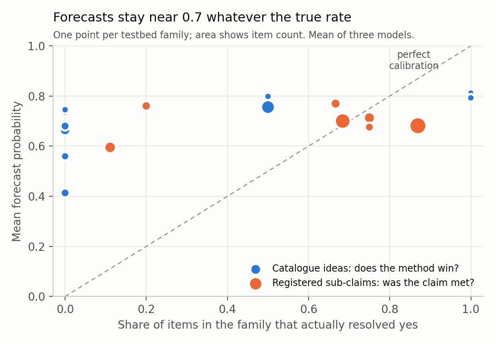
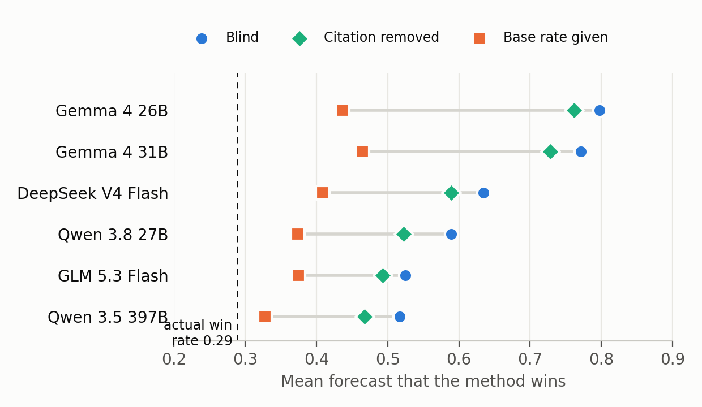

# Same Number, Different Question: LLM Forecasts of Alignment Experiment Outcomes Ignore the Base Rate

**Jaeson Booker** (AI Safety Research Fund) [confirm affiliation]

With Claude (Anthropic) as research assistant: code, analysis and drafting. The author directed the work and is responsible for all content.

Apart Research AI x Epistemics Sprint, November 2026. Track 1: Model Epistemics and Decision-Making Evals.

## Abstract

If language models are to help decide which research directions deserve effort, they need to know how likely an idea is to work. We test this on a catalogue of 45 alignment methods that were each run on a testbed with planted ground truth, giving verdicts that postdate every forecaster's training data. Six open models forecast three binary outcomes per method (114 questions) under a frozen pre-registration. On the primary question, whether a method beats a tuned baseline, the true rate is 29% and the pooled forecast averages 0.64, a bias of +0.35 (95% interval +0.21 to +0.52). Every model overpredicts. Models rank methods better than chance (pooled AUROC 0.66), yet none reliably beats a forecaster that always states the base rate. A second set of 74 pre-registered claims from the same research programme, 65% of which were met, shows why. The three models with complete data average 0.69 on that set and 0.70 on the first. Across testbed families whose true rates run from 0% to 100%, mean forecasts stay between 0.41 and 0.81. The apparent optimism is a fixed prior near 0.7 that does not respond to what is being asked. Supplying a reference-class rate moves forecasts toward it but does not improve discrimination. A bare citation raises confidence by 5 points.

(204 words)

## 1. Introduction

A recurring proposal in AI for epistemics is to use models as research triage: read a proposal, estimate whether it will work, and direct scarce effort accordingly. Alignment research is a natural target. It has many more ideas than people to test them, and a wrong estimate has a cost in both directions. Overconfidence sends effort toward methods that fail. A model that says the same thing about everything gives no guidance at all.

Testing this is hard for two reasons. Outcomes of research usually take months or years to resolve, and published results leak into training data. A model asked whether a known method works can recall the paper instead of forecasting.

We use a setting that avoids both problems. Alignment SynthCore is an open harness that runs alignment methods on small testbeds where the right answer is planted by construction: features put into a toy model on purpose, backdoors inserted into classifiers, gridworlds where reward hacking strictly pays. Each method gets a verdict from a fixed two-stage rule. The verdicts were produced between 15 October and 8 November 2026, after the training cutoff of every model we test, and they resolve in minutes of compute. Many of the methods come from published papers that report success, while most did not win here. That gap makes the setting a sharp test of whether a model prices an idea or repeats its reputation.

Our contributions:

1. A pre-registered forecasting audit of six open models on 114 resolved questions about 45 alignment methods, with a leakage probe.
2. A second, separately registered set of 74 claims with a very different base rate, which separates optimism about alignment methods from insensitivity to the question.
3. The finding that the models' forecasts are close to a constant. They overpredict where success is rare and look calibrated where it is common, for the same reason.
4. All items, prompts, cached model outputs and analysis code, so every number can be recomputed without new model calls.

## 2. Related Work

**Forecasting benchmarks.** ForecastBench (Karger et al., 2024) scores models on questions that resolve after their training cutoff and finds them behind expert forecasters. Our items resolve the same way, but concern experimental outcomes in one research field instead of world events, and resolve by computation.

**Predicting experimental results.** Luo et al. (2024) report that language models can beat neuroscientists at choosing the real result of a study from two candidate abstracts. Hewitt et al. (2024) find that models predict effect sizes in social science survey experiments well. Both test relative judgement between framed alternatives. We ask for an absolute probability, which is what a triage decision needs, and find the two abilities come apart.

**Replication forecasting.** Dreber et al. (2015) showed that prediction markets among researchers anticipate which psychology findings replicate. Our setting is a machine analogue: a method "replicates" if it survives a ground-truth test outside its original paper.

**Calibration and sycophancy.** Kalai et al. (2025) argue that training and evaluation reward confident guessing over stated uncertainty. SycEval (Fanous et al., 2025) and MASK (Ren et al., 2025) measure how model claims shift under social pressure. Our citation-removal condition is a mild version of the same question: does a prestige cue alone raise confidence?

[J: verify every reference against the source before submitting. I have not re-checked titles, years or author lists online.]

## 3. Methodology

### 3.1 Items

**Catalogue set (frozen first).** The catalogue held 45 tested ideas across 11 testbed families at the time of the freeze. Each idea yields up to three binary questions whose answers the harness fixed before any forecaster saw them:

- **Gate** (45 items, 53% yes). Did the method pass its registered mechanism gate, a comparison with the baseline at default settings on a small configuration?
- **Win** (45 items, 29% yes). Did it pass the gate and then beat the tuned baseline on the testbed's safety metric on held-out seeds, with an exact paired test at p < 0.05? This is the primary question.
- **Sign** (24 items, 79% yes). Given the full comparison ran, was the method's mean safety score above the baseline's?

A prompt gives the testbed description, what is planted, the metric, the baseline, the method and its source citation, and the registered gate quantity and threshold. It contains no verdict and no observed number. Two of the 45 ideas are null controls (a baseline compared with itself, and a random variant).

**Sub-claim set (Amendment 1).** The same repository contains confirmatory studies that each registered claims before a confirmation run. We extracted 74 such claims from 19 study reports in 7 testbed families; 65% were met. Each item has a design description without results, the registered claim, and its outcome. This set differs in kind. The claims are the research programme's own hypotheses, many of them measurement or sanity checks, and the design descriptions were written for this study with the outcomes in view.

### 3.2 Forecasters and conditions

Seven open models hosted by Adaption were planned: GLM 5.2, GLM 5.3 Flash, Qwen 3.5 397B, Qwen 3.8 27B, DeepSeek V4 Flash, Gemma 4 31B and Gemma 4 26B. Each call asks for brief reasoning and a final JSON probability, at temperature 1 with a 16,000-token output cap, three samples per cell. An item's forecast is the mean of its parsed samples. Models had no tools or retrieval.

Catalogue conditions:

- **Blind.** The prompt as described.
- **Base rate given.** Adds the yes-rate for the same question on the other testbed families (leave-one-family-out).
- **Citation removed.** The source line is deleted; the method name and description stay.

The sub-claim set uses blind and base rate given.

### 3.3 Pre-registration

Five hypotheses on the win question were frozen with file hashes before the first non-pilot call: H1 optimism (mean forecast above the observed rate), H2 discrimination (AUROC above 0.5), H3 no skill (Brier skill against the leave-one-family-out base rate at or below zero), H4 the reference class helps (lower Brier score with the base rate given), and H5 a citation raises forecasts. Each is judged by a 95% bootstrap interval that resamples testbed families, since ideas in one family are not independent. "Pooled" is the equal-weight mean of the models' forecasts per item. The registration did not define pooling; we fixed this before computing it.

A 10-item pilot preceded the freeze and agreed with H1, so H1 is less of a blind prediction than the others. Results are unchanged with the pilot items removed. Amendment 1 registered four claims for the sub-claim set before any forecast on it and before any main-run score was read.

### 3.4 Checks and deviations

- **Leakage probe.** With no context, each model was asked what it knows about the repository, then asked for the recorded verdict of each of the 45 ideas or "unknown". No model recognised the repository. Of 315 recall questions, 16 drew a named verdict and 6 were correct (38%), below the 47% that always naming the commonest verdict would score.
- **Failed calls.** The registered rule drops a model with more than 10% failed calls. GLM 5.2 spent its full token budget on reasoning and returned nothing on 40 of 57 calls and was dropped early. That decision used only token counts and empty outputs. On the catalogue set the other six models stayed under the cutoff (0% to 8.0%). On the sub-claim set, whose prompts are longer, three reasoning-heavy models exceeded it (26%, 28% and 45%) and are reported descriptively only.
- **A failed first run** made no model calls (a missing API key) and is logged.

Total cost was about 37 Adaption credits for roughly 9,000 model calls.

## 4. Results

### 4.1 Every model overpredicts wins

*Table 1. Primary question (win), blind condition. True rate 0.29. Intervals are 95%, bootstrapped over 11 testbed families.*

| Model | Mean forecast | Bias (H1) | AUROC (H2) | Brier skill (H3) |
| --- | --- | --- | --- | --- |
| Gemma 4 26B | 0.80 | +0.51 [+0.36, +0.68] | 0.69 [0.47, 0.99] | −0.93 [−3.05, −0.15] |
| Gemma 4 31B | 0.77 | +0.48 [+0.34, +0.65] | 0.74 [0.62, 0.98] | −0.81 [−2.73, −0.06] |
| DeepSeek V4 Flash | 0.63 | +0.35 [+0.22, +0.50] | 0.75 [0.62, 1.00] | −0.29 [−1.64, +0.21] |
| Qwen 3.8 27B | 0.59 | +0.29 [+0.14, +0.48] | 0.65 [0.54, 0.87] | −0.16 [−1.42, +0.30] |
| GLM 5.3 Flash | 0.52 | +0.22 [+0.06, +0.42] | 0.55 [0.37, 0.81] | −0.13 [−1.06, +0.22] |
| Qwen 3.5 397B | 0.52 | +0.23 [+0.08, +0.40] | 0.74 [0.61, 0.81] | +0.03 [−0.75, +0.30] |
| **Pooled** | **0.64** | **+0.35 [+0.21, +0.52]** | **0.66 [0.57, 0.89]** | **−0.30 [−1.59, +0.18]** |

**H1 is supported**, pooled and for all six models. The smallest bias is 22 points.

**H2 is supported** pooled and for four of six models. The models carry real information about which methods win.

**H3 is not supported as registered.** Skill is negative for five of six models, and significantly so for both Gemma models, but the pooled interval includes positive values. The accurate statement is that we find no evidence any model beats the base rate, not that we have shown they cannot.

The null control behaved as it should: every model gave the baseline-against-itself comparison a win probability between 0.00 and 0.03.

On the secondary questions the picture is weaker. For the gate question the pooled bias is +0.20 [+0.01, +0.42] and the pooled AUROC is 0.45 [0.35, 0.66], so the models cannot tell which mechanisms will show up at all. For the sign question, where 79% of answers are yes, the pooled bias is −0.02.

### 4.2 The same number on a different question

The sign result is a hint, and the sub-claim set confirms it. On 74 claims of which 65% were met, the three models with complete data forecast almost exactly what they forecast on the win question.

*Table 2. Mean blind forecast on each item set. The true rates differ by 36 points.*

| Model | Win question (29% yes) | Sub-claims (65% met) | Difference |
| --- | --- | --- | --- |
| Gemma 4 26B | 0.80 | 0.73 | −0.06 |
| Gemma 4 31B | 0.77 | 0.79 | +0.02 |
| Qwen 3.5 397B | 0.52 | 0.55 | +0.04 |
| Pooled (these three) | 0.70 | 0.69 | −0.00 |

Amendment claim A1 (a shift under 18 points) holds for all three. The three dropped models show the same pattern on the items they did answer (differences of 0.00, +0.02 and +0.12).



*Figure 1. Mean forecast against the true rate, one point per testbed family, for both item sets. Forecasts sit in a band around 0.7 while true rates span the whole range.*

Figure 1 shows the same thing by family. In the sub-claim set, families' met-rates run from 11% to 87% and the pooled forecast runs from 0.60 to 0.77. In the catalogue set, six families had no winning method and drew mean forecasts from 0.41 to 0.75.

This changes how H1 should be read. The models are not specifically optimistic about alignment methods. They hold a prior near 0.7 for "will this registered research claim come out as stated" and move little from it. Where success is rare the prior looks like optimism. Where success is common it looks like calibration: on the sub-claim set the pooled bias is +0.04 and pooled Brier skill is +0.13 [−0.04, +0.26]. Neither is evidence of knowing the answer.

The other amendment claims did not hold. Pooled AUROC on the sub-claims is 0.62 [0.47, 0.86], so discrimination is not established there (A2). Skill is not at or below zero (A3). The base rate did not help (A4, Brier change +0.03 [−0.01, +0.07]).

### 4.3 A reference class moves the level, not the ranking



*Figure 2. Mean win forecast per model under the three conditions.*

Given the base rate from other testbed families, every model's mean win forecast falls, to between 0.33 and 0.46 (Figure 2). **H4 is supported pooled, narrowly** (Brier change −0.08 [−0.17, −0.00]), and individually only for the two Gemma models, which had furthest to fall.

The gain is in level only. Discrimination gets worse: AUROC with the base rate given is between 0.37 and 0.58 across models, down from 0.55 to 0.75. Part of this is mechanical and is a flaw in our design. A leave-one-family-out rate is lower for families that did well and higher for families that did badly, so a model that anchors on it is pushed the wrong way item by item. The same effect appears on the sub-claim set. A reference class drawn from outside the item pool would give a fairer test.

### 4.4 A citation alone adds confidence

Removing the source citation lowers the pooled win forecast by 0.05 [+0.03, +0.07]. **H5 is supported** pooled and for five of six models. The effect is small next to the 35-point bias, and it understates the influence of reputation, since the method's name stays in the prompt and models may recognise it.

## 5. Discussion

**Ranking is not pricing.** The models rank alignment methods better than chance, which fits earlier findings that models predict experimental results in relative terms. A triage decision needs more than a ranking. It needs to know whether the best-ranked idea has a 70% or a 20% chance, and on that the models' numbers carry almost no information. Reporting AUROC alone would have made these models look useful for a job they cannot do.

**Calibration results depend on the base rate of the test set.** Had we run only the sub-claim set, we would have reported well-calibrated forecasters. Had we run only the catalogue set, we would have reported strong optimism about alignment research. Both readings are artefacts of one fixed prior. Any calibration evaluation that draws items from a single base rate is open to the same error. Varying the base rate across item sets is a cheap control.

**What a research assistant should do instead.** The base-rate condition shows the models do use a reference class when handed one. A system that looks up the track record of similar ideas before forecasting would likely fix the level. It would not fix discrimination, which needs the model to understand why a method fails on a particular testbed.

**Implications for automated alignment research.** Agents that propose and prioritise alignment experiments will lean on these judgements. A prior near 0.7 that most ideas work would, at a 29% true rate, send most effort to ideas that fail, and would give no signal to stop.

**Future work.** Larger item pools from other ground-truth testbeds; frontier models; reference classes from outside the item pool; and a pushback condition that tests whether a model abandons a forecast it has just verified.

## Appendix A. Limitations and Dual-Use / Ethical Considerations

**What the result does and does not establish.**

- **Small and clustered.** The catalogue set has about 34 independent ideas in 11 families, and the sub-claim set has 7 families. Intervals are wide. Two sub-claim families (23 items at 87% met, 9 items at 11% met) drive most of the base-rate spread.
- **One research programme.** All outcomes come from one harness, mostly at toy scale, and many implementations are simplified versions of the published methods. A verdict of "did not win here" is not a verdict on the paper. The 29% win rate is specific to this catalogue.
- **Sub-claim wording.** The design descriptions for the 74 sub-claims were written by an AI assistant that could see the outcomes. Wording may leak answers. Only 13 of the 74 outcomes were checked against a machine-readable summary; the rest were read from report tables.
- **Models.** Six open models, mid-sized by current standards. Nothing here shows frontier models behave the same way. On the sub-claim set only three models gave complete data.
- **Failed calls are not random.** Reasoning-heavy models ran out of tokens more often on some items, so their forecasts cover a selected subset.
- **Leakage cannot be ruled out,** only probed. The repository is public. Self-reported training cutoffs are weak evidence.
- **Pre-registration strength.** The freezes rest on local file hashes, not on a third-party timestamp. H1 was written before the pilot but the pilot agreed with it before the freeze. The pooling rule and the reading of H3 were fixed after the freeze.
- **The base-rate condition is confounded** by the leave-one-family-out construction described in Section 4.3.
- **Author involvement.** The author built the harness that produced the outcomes.

**Dual use.** The item set is a benchmark, and benchmarks can be trained on. A model tuned to score well here would learn this catalogue's base rates, not how to judge research. We publish the outcomes because reproducibility matters more for a first study, and recommend that later versions keep a held-out split. The finding itself could be misused to argue that model judgement of research is worthless in general, which the discrimination results do not support. The citation result shows a small lever for inflating a model's confidence in a claim by attaching a source; the effect is 5 points and we describe no method beyond adding a citation.

**Personal data.** None. The items describe published methods and synthetic experiments. Author names of cited papers appear in prompts as part of the citation.

**Use of AI tools.** An AI assistant wrote most of the code, extracted the sub-claims, ran the analysis and drafted this report under the author's direction. All reported numbers are recomputed by scripts in the repository from cached model outputs.

## References

[J: verify each entry before submitting.]

- Dreber, A., et al. (2015). Using prediction markets to estimate the reproducibility of scientific research. PNAS.
- Fanous, A., et al. (2025). SycEval: Evaluating LLM sycophancy.
- Hewitt, L., Ashokkumar, A., Ghezae, I., Willer, R. (2024). Predicting results of social science experiments using large language models.
- Kalai, A. T., Nachum, O., Vempala, S. S., Zhang, E. (2025). Why language models hallucinate.
- Karger, E., et al. (2024). ForecastBench: A dynamic benchmark of AI forecasting capabilities.
- Luo, X., et al. (2024). Large language models surpass human experts in predicting neuroscience results. Nature Human Behaviour.
- Ren, R., et al. (2025). The MASK benchmark: Disentangling honesty from accuracy in AI systems.

## Appendix B. Reproduction

Repository: github.com/jaebooker/alignment-synthcore, folder `experiments/epistemics_sprint/`. Pre-existing before the sprint: the SynthCore harness, the catalogue outcomes (`results/commons.json`), the study reports, and the Adaption client. New in the sprint: everything in that folder and the two pre-registration files in `prereg/`.

```
python build_items.py && python build_subclaims.py      # rebuild both item sets
python analyze.py data/forecasts.jsonl                    # per-model scores
python analyze_h.py win                                   # the five frozen hypotheses
python analyze_a.py                                       # Amendment 1 claims
python leak_probe.py -1                                   # leakage probe from cache
python make_figures.py
```

No command above makes a model call. `frozen_sha256.txt` holds the hashes recorded at each freeze and `DEVIATIONS.md` lists every departure from the registration.
